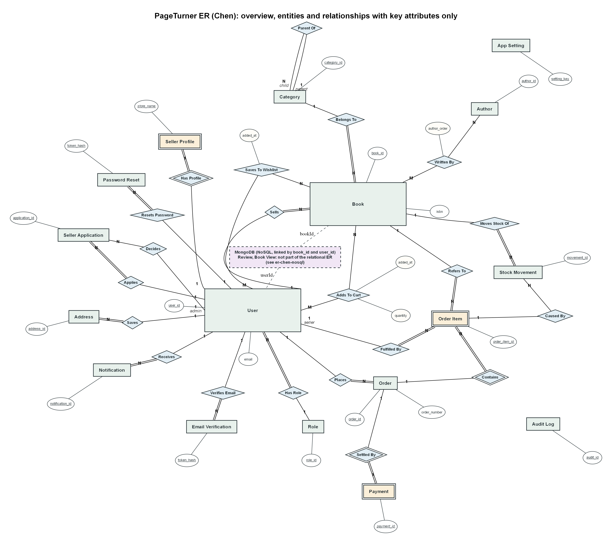

# Relational schema, keys and normalization

> **Analogy.** Think of the database as a school office. Every student has *one* file card (a row) and every card
> has *one* number (primary key). If a card says "see card #42" that is a foreign key. Normalization is the rule
> "write each fact on exactly one card, so when it changes you only fix it in one place."

## ER diagrams (Chen notation)

The entity-relationship model was drawn in Chen notation from the real schema (`01_schema.sql`, `08_features.sql`,
`10_se_requirements.sql`). One overview shows every entity and relationship with key attributes only; four detailed
diagrams show every attribute by domain. The MongoDB collections are drawn separately because they are not part of the
relational model. The Graphviz sources are in `docs/diagrams/` (`make_chen.py` rebuilds the `.dot`, `.png` and `.svg` files).

| Diagram | What it shows |
|---|---|
| [`er-chen-overview.png`](diagrams/er-chen-overview.png) | all 20 entities, all relationships, key attributes only |
| [`er-chen-users.png`](diagrams/er-chen-users.png) | users, roles, seller profile (weak), addresses, seller applications, e-mail verification, password reset, notifications |
| [`er-chen-catalogue.png`](diagrams/er-chen-catalogue.png) | books, categories (recursive), authors (M:N) |
| [`er-chen-orders.png`](diagrams/er-chen-orders.png) | cart, orders, order items (weak), payments (weak), stock movements |
| [`er-chen-other.png`](diagrams/er-chen-other.png) | wishlist, audit log, app settings |
| [`er-chen-nosql.png`](diagrams/er-chen-nosql.png) | MongoDB reviews and view events, linked to PostgreSQL by `book_id` and `user_id` only |

### Key to the notation

| Symbol | Meaning |
|---|---|
| Rectangle | entity |
| Double rectangle | weak entity (cannot exist without its owner: seller profile, order item, payment) |
| Diamond | relationship, named with a verb |
| Double diamond | identifying relationship of a weak entity (Has Profile, Contains, Settled By) |
| Ellipse | attribute; an underlined name is the primary key (for a weak entity, an italic underlined name is the partial key) |
| Double ellipse | multivalued attribute (only `helpfulBy` in the MongoDB review) |
| Dashed ellipse | derived attribute (`avg_rating`, `review_count`, `search_vector`, `total_cents`, `line_total_cents`, `helpfulCount`) |
| Ellipse with ellipses attached | composite attribute (the shipping address snapshot on an order) |
| Single line | partial participation |
| Double line | total participation (every instance must take part) |
| 1, N, M beside an entity | cardinality of that entity in the relationship |
| Attribute hanging off a diamond | relationship attribute (`quantity` on Adds To Cart, `author_order` on Written By) |
| Dashed rectangle | entity repeated from another diagram, key only |

Reading notes:
- Many-to-many relationships (Written By, Adds To Cart, Saves To Wishlist) are diamonds with M and N; the junction tables `book_authors`, `cart_items` and `wishlist_items` only appear later, in the relational mapping below.
- Foreign keys are not attributes in Chen notation; they are the lines to the relationship diamonds.
- Category has a recursive relationship (Parent Of) with role labels parent and child; a root category has no parent, so the child side is partial.
- `audit_log` has no relationships on purpose: `record_id` and `actor_id` are plain numbers so the log survives deletes.

## 1. Tables at a glance (20 in PostgreSQL)

| Group | Table | Primary key | Foreign keys → | Notes |
|---|---|---|---|---|
| Identity | `roles` | `role_id` | | `customer`, `seller`, `admin` |
| | `users` | `user_id` | `role_id → roles` | `email` CITEXT UNIQUE, bcrypt hash, lockout columns |
| | `seller_profiles` | `user_id` | `user_id → users` | **1:1** extension of users |
| | `seller_applications` | `application_id` | `user_id`, `decided_by → users` | partial UNIQUE: one *pending* per user |
| | `email_verifications` | `token_hash` | `user_id → users` | only the SHA-256 of the e-mail confirmation token is stored; one-time, expires |
| | `password_resets` | `token_hash` | `user_id → users` | only the SHA-256 of the token is stored |
| | `addresses` | `address_id` | `user_id → users` | max 5 per user (trigger), one default (partial unique index) |
| Catalogue | `categories` | `category_id` | `parent_id → categories` | **self-reference** → tree |
| | `authors` | `author_id` | | |
| | `books` | `book_id` | `seller_id → users`, `category_id → categories` | generated `search_vector` + GIN index |
| | `book_authors` | `(book_id, author_id)` | both | **M:N** between books and authors |
| Shopping | `cart_items` | `(user_id, book_id)` | both | **M:N** between users and books, quantity 1-10 |
| | `wishlist_items` | `(user_id, book_id)` | both | **M:N** |
| Orders | `orders` | `order_id` | `user_id → users` | address *copied in* (snapshot) |
| | `order_items` | `order_item_id` | `order_id`, `book_id`, `seller_id` | title and unit price *copied in* |
| | `payments` | `payment_id` | `order_id → orders` (UNIQUE → 1:1) | simulated gateway |
| | `stock_movements` | `movement_id` | `book_id`, `order_item_id` | ledger of every stock change |
| System | `audit_log` | `audit_id` | | JSONB before/after, written by triggers |
| | `notifications` | `notification_id` | `user_id → users` | in-app + simulated e-mail outbox |
| | `app_settings` | `setting_key` | | tax %, shipping fee, lockout rules |

Money is stored as **integer paise** (`price_cents`) so there is no floating-point rounding.

## 2. Constraints used (the database refuses bad data even for a superuser)

| Kind | Examples |
|---|---|
| `PRIMARY KEY` / identity | every table; `GENERATED ALWAYS AS IDENTITY` |
| `FOREIGN KEY` + action | `ON DELETE RESTRICT` for catalogue links (history survives), `CASCADE` for private rows (cart, wishlist) |
| `UNIQUE` | `users.email`, `seller_profiles.store_name`, `(parent_id, name)` with `NULLS NOT DISTINCT` |
| Partial `UNIQUE` index | one default address, one pending seller application |
| `CHECK` | price > 0, stock ≥ 0, rating range, ISBN format, status vocabularies, `ck_app_decided` |
| `NOT NULL` / `DEFAULT` | everywhere it makes sense |
| Generated column | `books.search_vector` (full-text) |

## 3. Normalization

**1NF** - every cell holds one value. Authors are *not* a comma list inside `books`; they live in `authors` + `book_authors`.

**2NF** - no attribute depends on *part* of a composite key. In `book_authors(book_id, author_id, author_order)` the
`author_order` depends on the *pair*; nothing else is stored there. In `cart_items(user_id, book_id, quantity)`
`quantity` depends on the pair.

**3NF / BCNF** - no attribute depends on a non-key attribute.

| Table | Functional dependencies | Why it is in BCNF |
|---|---|---|
| `users` | `user_id → name, email, password_hash, role_id, status…`; `email → user_id` | both determinants are candidate keys |
| `books` | `book_id → all`; `(seller_id, isbn) → book_id` | determinants are keys. Category *name* is **not** here; only `category_id` |
| `categories` | `category_id → name, parent_id`; `(parent_id, name) → category_id` | both are keys |
| `orders` | `order_id → all`; `order_number → order_id` | both keys |

### Deliberate, documented denormalization (the "why")

| Copy | Why it is correct anyway |
|---|---|
| `order_items.title_snapshot`, `unit_price_cents` | An invoice must show what the customer **paid then**, even if the book is renamed or repriced tomorrow. It is a historical fact, not a duplicate of the live value. |
| `orders.ship_*` | Same idea: the address on the parcel must not change if the customer edits their address book. |
| `books.avg_rating`, `review_count` | A cached aggregate of the MongoDB reviews so the catalogue can sort by rating with one indexed query. `sp_set_rating_summary` is the only writer. |
| `order_items.seller_id` | Lets Row Level Security give a seller exactly their own lines without a join. |

## 4. The MongoDB side (NoSQL)

| Collection | One document looks like | Why NoSQL fits |
|---|---|---|
| `reviews` | `{ bookId, userId, userName, rating, title, body, helpfulBy:[userId…], helpfulCount, createdAt }` | A review is a self-contained object, write-heavy, never joined inside a transaction. The array `helpfulBy` makes "one vote per person" a single atomic update. |
| `book_views` | `{ bookId, userId?, at }` | Append-only click-stream; a **TTL index** deletes events after 30 days with no code. |

Indexes: unique `{bookId, userId}` (one review per person per book), `{bookId, createdAt}` (list a book's reviews), TTL on `book_views.at`.
Validation: `$jsonSchema` validators reject malformed documents inside the database.
The two databases are linked only by the numeric ids, and by the rating summary that MongoDB's aggregation computes and PostgreSQL stores.
