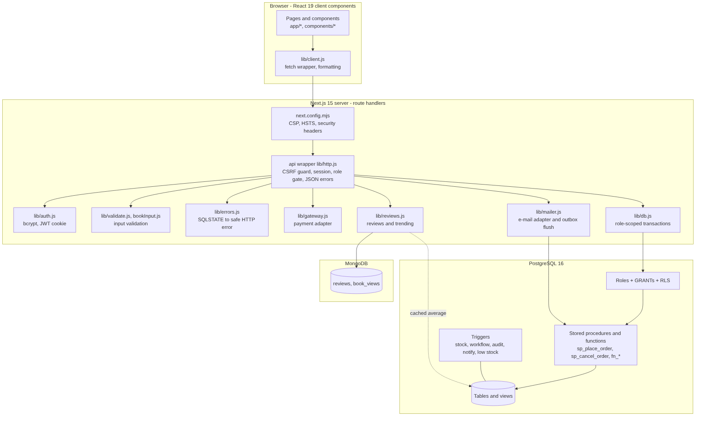
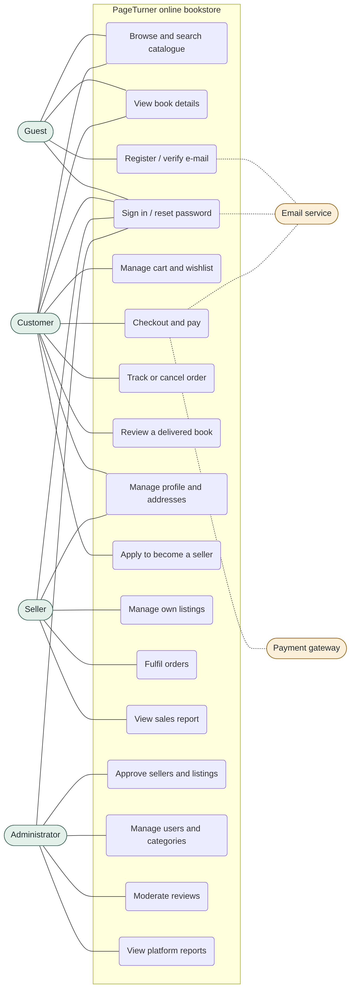
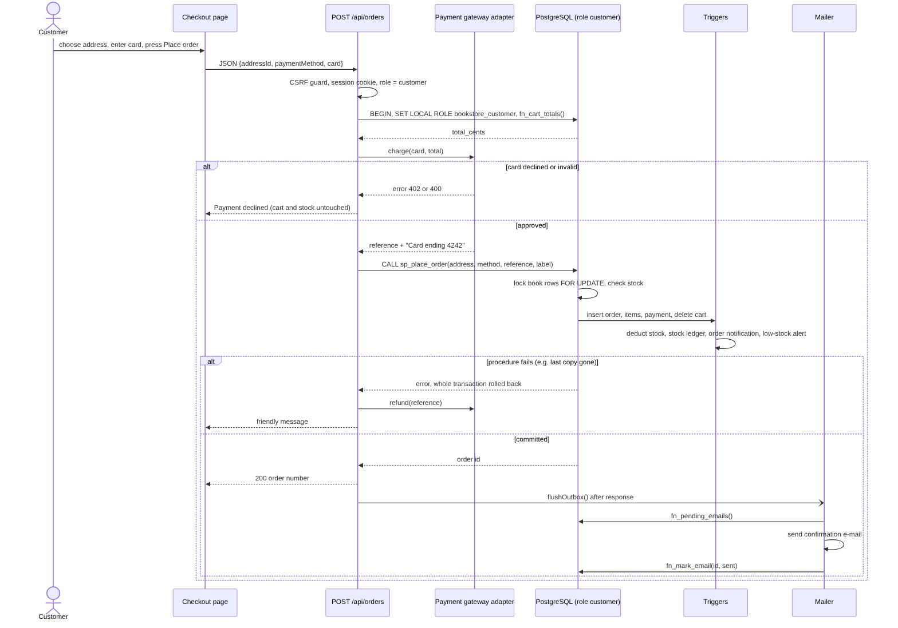
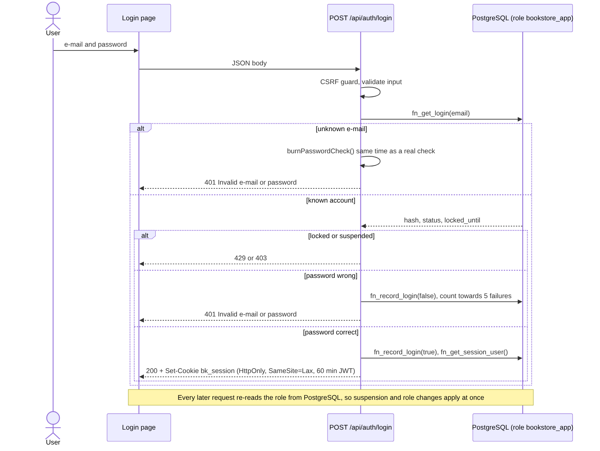
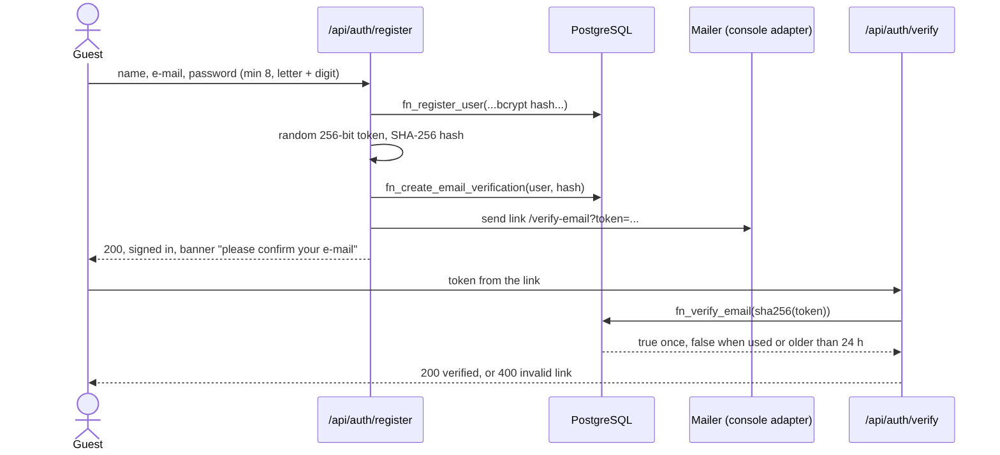

# Architecture and Design Specification - PageTurner Online Bookstore

## 1. Architecture pattern
**Layered monolith with the database as the security and integrity layer** (modular monolith).

* Presentation: React 19 pages (Next.js App Router).
* Application: Next.js route handlers - thin: validate, call the database, shape JSON.
* Data: PostgreSQL holds the rules (constraints, triggers, stored procedures, row-level security); MongoDB holds reviews and view events.
* External services behind adapters: `lib/gateway.js` (payments), `lib/mailer.js` (e-mail).

*Why:* a bookstore is transaction-heavy (stock, orders, money), so correctness lives where the data is. One deployable unit keeps a small team's operations simple, and the adapters mean a real payment or mail provider can be dropped in without touching the routes.

## 2. Component diagram

| Component | Responsibility | Source |
|---|---|---|
| Pages / components | rendering, forms, client-side state | `src/app`, `src/components` |
| API wrapper | CSRF guard, session lookup, role gate, JSON errors | `src/lib/http.js` |
| Auth | bcrypt, signed httpOnly cookie | `src/lib/auth.js` |
| Validation | reject junk before SQL | `src/lib/validate.js`, `bookInput.js` |
| Error mapper | SQLSTATE to safe HTTP messages | `src/lib/errors.js` |
| DB access | one transaction per request, `SET LOCAL ROLE` | `src/lib/db.js` |
| Gateway adapter | charge, refund, no card storage | `src/lib/gateway.js` |
| Mailer | console transport + outbox flush | `src/lib/mailer.js` |
| Reviews | MongoDB reviews, aggregation, trending | `src/lib/reviews.js` |
| PostgreSQL | tables, roles, RLS, procedures, triggers | `db/postgres/*.sql` |

## 3. Use cases

## 4. Requirement traceability (summary)
| Requirement group | Component(s) | Detail |
|---|---|---|
| FR-01..03 accounts | Auth, Mailer, `fn_register_user`, `email_verifications`, `password_resets` | [se-traceability.md](../se-traceability.md) |
| FR-04..07 catalogue | `v_book_catalog`, `search_vector` GIN index, `fn_category_tree` | |
| FR-08..14 cart to payment | `sp_place_order`, `fn_cart_totals`, Gateway, outbox | |
| FR-15..17 orders and reviews | triggers, `sp_cancel_order`, Reviews (MongoDB) | |
| FR-19..28 seller / admin | role-gated routes, RLS, `fn_decide_seller_application`, `fn_sales_report` | |
| FR-29, FR-30 | GRANT + RLS + `FOR UPDATE` locks | |
| VFR-01..15 | see the matrix | |

## 5. Security architecture
Defence in depth - a mistake in one layer does not become a breach.

| Layer | Control |
|---|---|
| Transport / browser | HSTS, CSP (own scripts only, no framing, no plugins), `nosniff`, referrer policy, permissions policy |
| Request | JSON-only bodies and same-origin check (CSRF), input validation, generic errors |
| Identity | bcrypt (cost 10), 60-minute JWT in an httpOnly SameSite=Lax cookie, lockout after 5 failures for 15 minutes, identical answer for unknown e-mail and wrong password, constant-time dummy hash |
| Authorisation | route role gate **and** PostgreSQL: `NOINHERIT` login role, `SET LOCAL ROLE` per request, column-level GRANTs, row-level security, `SECURITY DEFINER` procedures that call `fn_require_role` |
| Data | parameterised SQL only, CHECK / UNIQUE / FK constraints, reset and verification tokens stored as SHA-256 hashes, card data never stored (only reference + last 4 digits) |
| Audit | trigger-written `audit_log` for moderation, suspension, settings, categories |

Threats considered: injection, XSS, CSRF, session forgery, brute force, account enumeration, privilege escalation (a customer cannot call seller functions or write `role_id`), overselling under concurrency, replay of reset links.

## 6. Sequence diagrams
### 6.1 Checkout and payment (FR-11..14, FR-30)

### 6.2 Login with lockout (FR-02, VFR-07)

### 6.3 Registration and e-mail verification (FR-01)

## 7. API design
* REST over JSON, cookie session, resources under `/api/...`; 60 operations listed in [../openapi.yaml](../openapi.yaml) (generated by `npm run openapi`, checked by CI).
* Role per operation is declared in the route (`api(handler, { roles })`) and repeated by the database.
* Pagination: `?page=&limit=` (default 20, max 40); filters `q, category, language, minPrice, maxPrice, minRating, inStock, sort`.
* Money is integer paise (`*_cents` fields); dates are ISO 8601.
* Idempotent where it matters (wishlist add, helpful votes); order creation is one atomic procedure call.

| Group | Examples |
|---|---|
| Auth | `POST /api/auth/register`, `/login`, `/logout`, `/verify`, `/resend-verification`, `/forgot`, `/reset` |
| Catalogue | `GET /api/books`, `/api/books/{id}`, `/api/categories`, `/api/languages`, `/api/trending` |
| Customer | `/api/cart`, `/api/wishlist`, `/api/addresses`, `/api/orders`, `/api/orders/{id}/cancel`, `/api/books/{id}/reviews` |
| Seller | `/api/seller/books`, `/api/seller/orders`, `/api/seller/report`, `/api/seller-application` |
| Admin | `/api/admin/users`, `/api/admin/books`, `/api/admin/seller-applications`, `/api/admin/categories`, `/api/admin/report`, `/api/admin/audit`, `/api/admin/settings` |
| Ops | `GET /api/health` |

## 8. Error handling
| Situation | Status | Behaviour |
|---|---|---|
| Bad input | 400 | message names the field; database CHECK failures map to friendly text |
| Not signed in / wrong role | 401 / 403 | same shape for route gate and database refusal |
| Not found or not yours | 404 | RLS hides other users' rows, so "not yours" looks like "not found" |
| Conflict (duplicate, stock, illegal status jump) | 409 | message written in the procedure that raised it |
| Wrong content type | 415 | JSON only |
| Payment declined | 402 | cart and stock untouched, nothing to refund |
| Too many failed logins | 429 | account locked for 15 minutes |
| MongoDB down | 503 on reviews only | shop keeps working, trending is empty |
| Anything unexpected | 500 | generic text; details only in the server log, never SQL or stack traces |

Failure handling around money: charge first, create the order second; if order creation fails the charge is refunded; cancelling a paid order refunds through the gateway and marks the payment `Refunded`.
